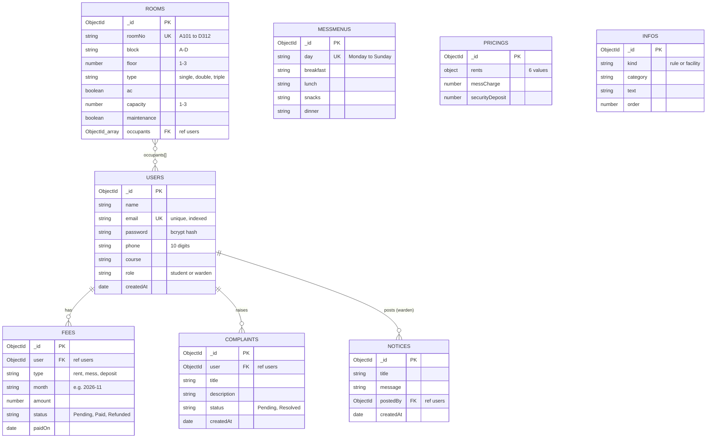

# Nestora: Schema Diagram and CO Mapping

## 1. Database schema diagram (ERD)

`messmenus`, `pricings` and `infos` have no relations to other collections.

## 2. Schema outline

| Collection | Key fields                                            | Relations             | Indexes                                     |
| ---------- | ----------------------------------------------------- | --------------------- | ------------------------------------------- |
| users      | name, email, password, phone, course, role            | none                  | unique on email                             |
| rooms      | roomNo, block, floor, type, ac, capacity, maintenance | occupants[] ref users | unique on roomNo; compound on block + floor |
| fees       | type, month, amount, status, paidOn                   | user ref users        | status                                      |
| complaints | title, description, status                            | user ref users        | status                                      |
| notices    | title, message                                        | postedBy ref users    | none                                        |
| messmenus  | day, breakfast, lunch, snacks, dinner                 | none                  | unique on day                               |
| pricings   | rents, messCharge, securityDeposit                    | none                  | none (one document)                         |
| infos      | kind, category, text, order                           | none                  | none                                        |

Computed (not stored): room status (Vacant, Partially filled, Full, Maintenance) and the fee Overdue tag.

## 3. CO mapping

### CO3: Frontend (React)

| Requirement                            | Where it is satisfied                                                                                                                                                 |
| -------------------------------------- | --------------------------------------------------------------------------------------------------------------------------------------------------------------------- |
| Modular reusable functional components | `client/src/components`: Navbar, Sidebar, Modal, Loader, EmptyState, ErrorState, StatusTag, ProtectedRoute                                                            |
| useState and useRef                    | Every form page (`useState`); `Register.jsx` uses `useRef` to focus the first field; `ToastContext` uses `useRef` for the id counter                                  |
| Context API                            | `AuthContext` (user, login, logout) and `ToastContext` (toast alerts)                                                                                                 |
| Loading, empty, error states           | `Loader`, `EmptyState`, `ErrorState` used on every data page                                                                                                          |
| react-router-dom                       | `App.jsx`: BrowserRouter, Routes, Route; `Link`/`NavLink` in Navbar and Sidebar; `useNavigate` in Login and Register; `useParams` in `RoomDetails.jsx` (`/rooms/:id`) |
| Controlled forms with validation       | `Register.jsx`, `MyComplaints.jsx`, `ManagePricing.jsx`, all modal forms                                                                                              |

### CO4: Backend (Node, Express, Mongoose)

| Requirement                                        | Where it is satisfied                                                                                                                            |
| -------------------------------------------------- | ------------------------------------------------------------------------------------------------------------------------------------------------ |
| RESTful GET, POST, PUT, DELETE                     | All route files in `server/routes` (see `docs/API.md`)                                                                                           |
| `express.Router()`                                 | One router file per feature                                                                                                                      |
| Custom middleware                                  | `logger.js` (request logger), `auth.js` (JWT), `role.js` (warden only), `validate.js` (input validation), `errorHandler.js` (centralized errors) |
| Mongoose schemas with types, required, validation  | `server/models` (8 schemas; enums, regex, min, minlength)                                                                                        |
| Relations with ref and populate()                  | rooms.occupants, fees.user, complaints.user, notices.postedBy; `populate()` in room, fee, complaint and notice controllers                       |
| Controllers with async/await CRUD and status codes | `server/controllers`: 200, 201, 400, 401, 403, 404, 500                                                                                          |
| Structure routes, controllers, models, middleware  | `server/` folder layout                                                                                                                          |

### CO5: Integration, security, optimization

| Requirement                                    | Where it is satisfied                                                                                                    |
| ---------------------------------------------- | ------------------------------------------------------------------------------------------------------------------------ |
| React connected to Express with axios          | `client/src/api.js` (axios instance, request interceptor adds the token)                                                 |
| CORS                                           | `server.js`: `cors({ origin: CLIENT_URL })`                                                                              |
| dotenv environment variables                   | `server/.env` (PORT, MONGO_URI, JWT_SECRET, ...) and `client/.env` (VITE_API_URL)                                        |
| JWT authentication                             | `authController.js` (token on login and register), `auth.js` (verify), `ProtectedRoute` on the frontend                  |
| bcrypt password hashing                        | `authController.js` (`bcrypt.hash`, `bcrypt.compare`)                                                                    |
| Role-based views                               | Student and warden sidebars; warden routes guarded by `wardenOnly` on the server and `ProtectedRoute role` on the client |
| Centralized error handling, toasts and loaders | `errorHandler.js`; `ToastContext`; `Loader` component                                                                    |
| schema.index()                                 | `rooms` (block + floor), `fees` (status), `complaints` (status)                                                          |
| Mongoose aggregate() for statistics            | `getRoomStats` (per block, floor, type, AC) and `getFeeStats` (collected vs pending)                                     |
| Real-time updates                              | `useFetch` hook polls every 5 seconds with `setInterval` and cleanup                                                     |
